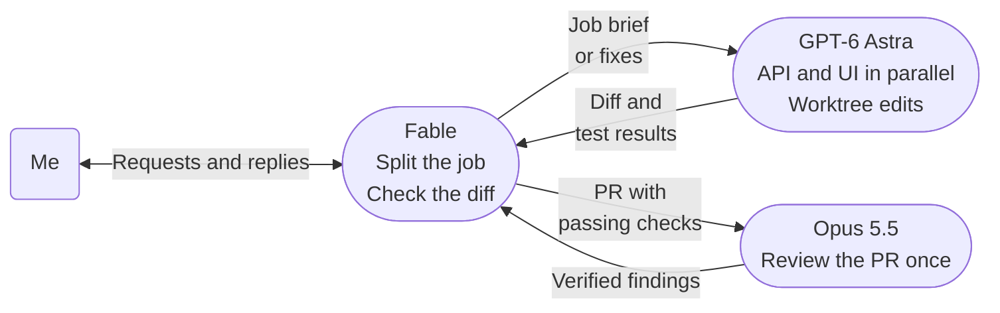
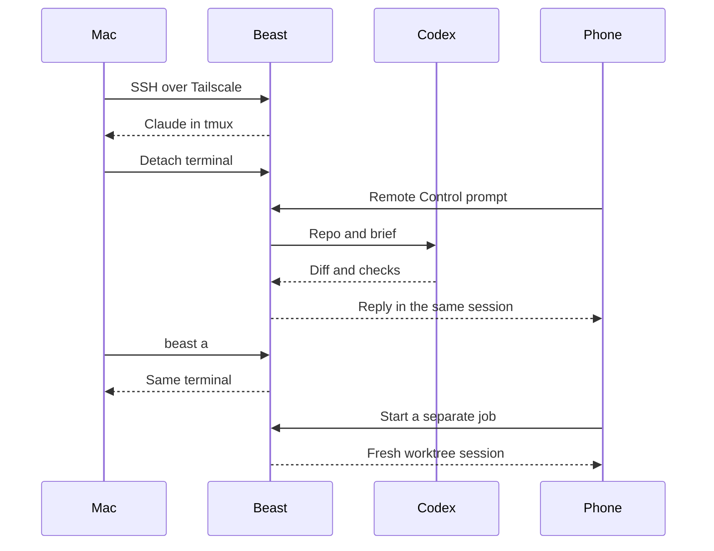
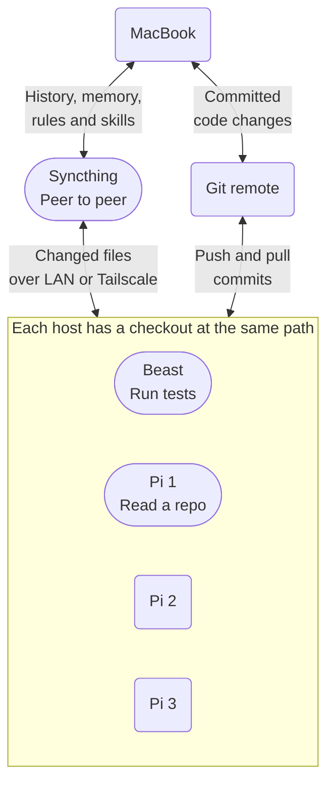

Every single day my 16 GB M2 MacBook Pro was crashing. I was running a bunch of Claude and Codex sessions in parallel. Sometimes even one multi-agent run would take down the whole laptop. Then I'd have to sit there and wait. It was very, very annoying.

I had a few things to figure out.

- Where could I put the next job when my Mac was already full?
- If I moved it, how would Claude remember what we'd already tried?
- Could I close the laptop and pick up that same job from my phone?

## How I run Claude and Codex

I'd already built an agent harness around the way I like to work. I talk to Claude about a change. Claude figures out what to hand to Codex. The harness includes the rules they follow, the skills they use and the machines where they can open my repos and run the code.

I usually brainstorm with Fable. Sometimes I use Opus for that. Once we agree on what to do, I want Codex reading the code, checking the docs and trying the change. Fable writes a brief for each independent job. It includes the repo, the rules that apply there and what I expect back.

Say I want to make a display name optional in an API. I'd want to know where the backend sets it and what the frontend does if it's missing. Claude can start two read-only Codex runs with `codex exec`. The one looking at the frontend doesn't need to wait for the one reading the API.

Both runs send their findings back to Claude. If the frontend answer is missing something, Claude can resume that same Codex session and ask it to follow the caller. Once we're ready to edit, parallel changes get separate Git worktrees. Codex runs the tests and type checks. Claude reads the results and the diff. From my side it's still the conversation where I asked about the display name.

Opus reviews the PR with a skill I used to run in GitHub Actions. I'll write about that in a separate post.

## What I tried

Cloud VMs gave me somewhere to run more jobs. I was already paying for a few, though, and that was adding up. Buying a bigger Mac was another option. Meanwhile the PC sitting in my office had about twice as much RAM as my Mac. I also had Raspberry Pis at home.

I tried Conductor and T3 Code. The bit I liked about T3 was that I could leave my sessions on one machine and get to them from another. I just didn't like using another interface. I was used to mine.

By then the harness worked the way I wanted. I just needed somewhere else to run it. I started with the office PC. I call it Beast.

## Beast had the repo. I wanted my conversation too.

I cloned a repo onto Beast and opened Claude there. That took the work off my Mac right away. Beast could run the commands and tests. The annoying part was that I'd already talked through the change on my Mac. I wanted to pick up from the message where we'd decided what to do.

Claude Code and Codex save their conversations in files. So I set up Syncthing between the Mac and Beast. It copies the session histories, saved memory, rules and skills in both directions. The first sync moved about 7 GB over Wi-Fi.

One thing I didn't expect was that Claude cared where I put the repo. It looks up a project's history by the real path of its folder. The same repo in my Linux home directory looked like a different project. I tried a symlink. Claude followed it straight back to the Linux path. So now the repo lives at the same path on both machines.

To test it, I asked Claude on Beast which cloud account I use for development. I'd saved that detail on my Mac. Beast had it. I stopped the session, resumed it on the Mac and added a reply. When I opened it on Beast again, I could see the reply I'd just written.

If Beast goes offline, I can pick up the last synced conversation on my Mac with `claude --resume`. Codex has `codex resume` for that too. I stop a session before I run it somewhere else. The code still goes through Git. If I left an uncommitted edit on Beast, that's where it is.

## Picking it up from my phone

Most days Beast is fine. I'm the one getting up to go somewhere. In that case there's no reason to move the session. I just want to open it on my phone.

At my desk I open a repo on my Mac and type `beast`. That's the little CLI I wrote. It uses regular SSH over Tailscale to connect to the office PC and opens Claude in the matching folder inside tmux. Ctrl-b, then d lets me detach and close the lid. When I'm back at my desk, `beast ls` lists my sessions. I can give `beast a` a few words from a title to get that terminal back.

On my phone I just use Claude. Remote Control comes on when a session starts, so I can open the Code tab in the app, pick that conversation and tell it what to do next. My Mac can be asleep the whole time.

Sometimes what I want to do next is a different job altogether. I can start that one from the phone too. I pick the repo and the new session gets its own worktree on Beast. Both jobs can be editing code at the same time.

I did hit a snag away from home. I'd run `beast` and the terminal would just sit there. Tailscale SSH was waiting for a browser approval. I switched to regular SSH over Tailscale so it could use my SSH key. The CLI now stops waiting after ten seconds and tells me whether the PC is offline or the login got stuck.

## How I ended up with three Raspberry Pis

Beast was the first machine I moved work onto. Then I connected a Raspberry Pi at home. That gave me a three-way sync between my Mac, Beast and the Pi. If Beast was busy, I could start a separate session on the Pi. My rules and project memory were already there.

As I started running more jobs at once, I added a second Pi and then a third. Each one got a checkout at the same path and the same Syncthing folders. That's my little cluster now.

Say Beast is running tests. I can give a Pi a different repo to investigate and let both jobs carry on. The tests use Beast's RAM. The investigation uses the Pi's CPU and RAM. What they share is the context I'd otherwise have to give each agent again.

I've been using some version of this for about three months. I already pay for Claude and Codex to run the models. To run more sessions on hardware I own, I don't have to buy cloud compute credits, rent another VM or pay for a separate hosted workspace. I can just connect the next machine.

## What I still use my Mac for

My Mac is mostly an interface now. I use its terminal to get to Beast, or open Chrome when I want a big screen for a review. The repo, the tests and the agents can stay on the office PC or a Pi. Starting another Codex job over there barely touches the 16 GB on my laptop.

Most of my back and forth with Claude was already me talking into Wispr Flow. That's just as easy on my phone.

A few months ago I was thinking about buying a bigger Mac. Lately I've been wondering how much review I could get done on a folding phone. [I wrote about that here.](https://www.linkedin.com/posts/vanshsood_most-of-my-agents-are-running-in-sandboxes-activity-7527717312884355072-nTja)
